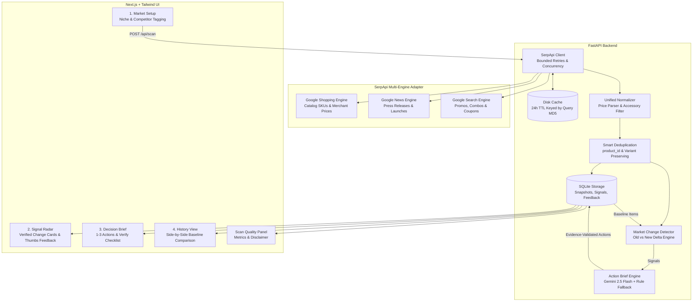

# 🌊 RippleWatch

> **AI Market-Change Intelligence Agent for Small Businesses**  
> *Built for the SerpApi Hackathon · Decision Intelligence over Price Tracking*

[](https://fastapi.tiangolo.com)
[](https://nextjs.org)
[](https://serpapi.com)
[](https://ai.google.dev/)
[](https://opensource.org/licenses/MIT)

---

## 💡 The Problem

Small businesses and direct-to-consumer (D2C) brands cannot afford $10,000+/year enterprise intelligence platforms, nor do they have the bandwidth to monitor multiple competitor storefronts daily.

Existing low-cost tools fail because they are **noisy price-tracker dashboards**:
- They dump endless tables of minor price fluctuations without context.
- They miss product bundle shifts, combo offers, and strategic press releases.
- They offer no actionable guidance on what a small brand should actually *do*.

**RippleWatch** flips this model on its head. It is **NOT** a price tracker dashboard. It is an **AI market-change agent** that:
1. Watches the public market across **Google Shopping**, **Google News**, and **Google Search** via **SerpApi**.
2. Normalizes, deduplicates, and filters out catalog noise (like accessories and replacement parts).
3. Compares the current market against a baseline snapshot to detect meaningful shifts (**Price Cuts ≥5%**, **Promotional Bundles**, **New SKU Launches**, and **Media Coverage**).
4. Delivers an **Executive Action Brief**: 1–3 prioritized, low-cost commercial next actions backed strictly by clickable source evidence.

---

## 🏛️ System Architecture



---

## 🔍 How SerpApi Is Used

RippleWatch leverages SerpApi's multi-engine capabilities to build a 360-degree view of competitor behavior:

| Engine | Query Strategy | Information Extracted |
| :--- | :--- | :--- |
| `engine=google_shopping` | `"{competitor} {category}"` | Real-time merchant prices, product titles, retailer domains (Amazon IN, Flipkart, direct stores), product IDs, delivery notes. |
| `engine=google_shopping` | `"{competitor} {category} bundle OR combo OR offer"` | Multi-pack bundles, twin packs, gift sets, and promotional packaging. |
| `engine=google_news` | `"{competitor}" {category} launch OR release OR price` | Factory expansions, green packaging initiatives, brand strategy shifts, executive announcements. |
| `engine=google_search` | `"{competitor} {category} discount sale coupon deal"` | Organic promotional campaigns, festival discounts, and clearance pages. |

### Quota Protection & Disk Caching
- **Disk Cache**: Every raw SerpApi response is hashed (`MD5(engine + query + gl + hl)`) and cached on disk with a **24-hour TTL**.
- **Toggle Switch**: A top-bar UI switch allows developers and judges to toggle caching on or off at will.
- **Resilience**: Up to 3 bounded retries with exponential backoff on HTTP 429 / 5xx rate limits or upstream timeouts.

---

## ⚙️ Environment Configuration

RippleWatch requires configuration via `.env`. A template is provided in `.env.example`:

```bash
# .env.example

# SerpApi Key (Required for live market searches)
# Get a free key at https://serpapi.com
SERPAPI_KEY=your_serpapi_api_key_here

# Google Gemini API Key (Optional)
# Powers the AI Action Brief via the google-genai SDK.
# If omitted or if calls fail, RippleWatch automatically falls back to a deterministic rule-based brief.
GEMINI_API_KEY=your_gemini_api_key_here

# Backend settings
HOST=0.0.0.0
PORT=8000
DATABASE_URL=sqlite:///./ripplewatch.db
CACHE_DIR=./cache
CACHE_TTL_HOURS=24
```

> **Security Note**: Never commit `.env` to version control. Keys are never exposed to the client frontend.

---

## 🚀 Quickstart & Setup Instructions

### Prerequisites
- **Python**: 3.10+
- **Node.js**: 18+ (tested with Node 20 and 24)
- **SerpApi API Key**: [Sign up at serpapi.com](https://serpapi.com)

### 1. Clone & Configure
```bash
git clone https://github.com/your-username/RippleWatch.git
cd RippleWatch

# Copy environment template
cp .env.example .env
# Edit .env and paste your SERPAPI_KEY (and optional GEMINI_API_KEY)
```

### 2. Run Backend
```bash
# Set up Python virtual environment
python -m venv .venv

# Activate virtual environment
# Windows:
.venv\Scripts\activate
# macOS/Linux:
source .venv/bin/activate

# Install backend dependencies
pip install -r backend/requirements.txt

# Start FastAPI server
cd backend
python -m uvicorn app.main:app --host 0.0.0.0 --port 8000 --reload
```
Backend API will be live at: `http://localhost:8000` (Interactive docs at `http://localhost:8000/docs`).

### 3. Run Frontend
```bash
# In a separate terminal:
cd frontend
npm install
npm run dev
```
Open `http://localhost:3000` in your browser.

---

## 🧪 Running Automated Tests

RippleWatch includes a comprehensive test suite covering schema normalization, variant-preserving deduplication, change detection, confidence scoring, and rule-based brief synthesis:

```bash
# Activate virtual environment and run pytest
.venv\Scripts\python.exe -m pytest -v backend/tests
```

**Test Coverage Highlights**:
- ✅ Price extraction from diverse regional formats (`₹1,299`, `Rs. 850`, `$24.99`).
- ✅ Noise filtering: Accessory detection (cleaning brushes, silicone sleeves, replacement caps) vs authentic water bottles.
- ✅ Variant deduplication: Matches on `product_id` and `normalized_title + seller` while preserving 500ml vs 1000ml bottle variants.
- ✅ Change Detector cases:
  - `PRICE_CHANGE` (≥5% price drops / increases).
  - `PROMOTION` (combo and pack-of-2 appearance).
  - `NEW_PRODUCT` (unseen competitor model).
  - `NEWS` (relevant media coverage).
  - `No-Change` & `No-Results` scenarios.
  - Multi-source confirmation elevating confidence to `confirmed`.
  - User feedback suppression loop.
- ✅ Action Brief server-side evidence validation (discards hallucinated IDs).

---

## 🖥️ Screen Guide

1. **Setup Screen**:
   - Configure business profile, category, and market (`reusable steel water bottles, India`).
   - Track 2–5 competitors (`Milton`, `Cello`, `Borosil`).
   - **"Suggest Competitors"** button automatically queries SerpApi to identify top regional brands.
   - **"Load Sample Baseline"** loads an older 14-day market state for rapid change comparison testing.
   - **"Save Real Baseline"** captures a real SerpApi run as the active baseline.
   - **"Run Market Scan"** triggers live multi-engine ingestion.

2. **Signal Radar Screen**:
   - 3–5 clean signal cards featuring:
     - Type badges (`NEW_PRODUCT`, `PRICE_CHANGE`, `PROMOTION`, `NEWS`).
     - Confidence pills (`Confirmed (2+ Sources)`, `Likely`, `Possible`).
     - Delta description explaining old vs new state.
     - Clickable source pills (direct links to Amazon IN, Flipkart, brand sites).
     - Signal limitations notice.
     - **Useful / Irrelevant** feedback buttons to train the suppression filter.

3. **Executive Action Brief Screen**:
   - 1–3 high-leverage, practical next actions:
     - Clear imperative title (e.g., *"Highlight build quality and warranty over price matching against Milton"*).
     - Commercial rationale.
     - Effort badge (`Low`, `Medium`, `High`).
     - Interactive **"Verify Before Acting"** checklist with clickable checkmarks.
     - Direct evidence citations linking to the exact source listings.
     - Governance notice: **Human Approval Only · Never Auto-Repricing**.

4. **Snapshot History Screen**:
   - Side-by-side comparison of baseline vs current live scan.
   - Color-coded highlights for price cuts, promotional bundles, and newly cataloged SKUs.
   - Ability to promote any past scan to become the active baseline.

5. **Scan Quality Panel**:
   - Real-time transparency metrics:
     - Total results fetched.
     - Duplicates merged.
     - Noise items filtered.
     - % of claims with live source links (100%).
     - Explicit disclosure on prototype scope.

---

## 📊 Evaluation & Quality Metrics

RippleWatch is evaluated across five key criteria:
1. **Signal Precision**: Ratio of meaningful commercial shifts to total raw results (noise filter eliminates accessories like brushes and spare lids).
2. **Evidence Integrity**: 100% of generated recommendations are verified server-side to reference real item and signal IDs.
3. **Multi-Source Corroboration**: Signals observed across 2+ platforms (e.g. Amazon + Flipkart) are automatically elevated to `confirmed` status.
4. **Latency & Quota Efficiency**: 24h disk caching enables sub-second responses on repeated demo queries and protects SerpApi quota.
5. **Human Governance**: Zero autonomous price-setting or speculative sales/inventory inferences.

---

## ⚠️ Prototype Limitations

- **Delivery & Regional Variations**: Final checkout prices on Amazon/Flipkart may vary based on PIN code and prime delivery status.
- **Card-Specific Discounts**: Instant bank card cashbacks (e.g. HDFC 10% instant discount) applied at checkout are not reflected in base listing prices.
- **Real-Time Stock Availability**: SerpApi reflects public catalog search visibility; warehouse micro-stockout states are not verified.

---

## 🗺️ Future Roadmap

- [ ] **Multi-Region Support**: Expand beyond India (`gl=in`) to US, UK, EU, and Southeast Asian retail indexes.
- [ ] **Scheduled Cron Scanning**: Automated periodic scans (daily / weekly) with email summaries.
- [ ] **Competitor Footprint Heatmap**: Visual map of retailer channel presence (Amazon vs Quick-Commerce vs D2C).
- [ ] **Custom Category Taxonomy**: User-defined noise rules for apparel, electronics, and food & beverage niches.

---

## 👥 Authors & Acknowledgments

- Built for the **SerpApi Hackathon**.
- Powered by [SerpApi](https://serpapi.com) Google Shopping, News, and Search engines.
- AI Action Brief powered by [Google Gemini](https://ai.google.dev/).
