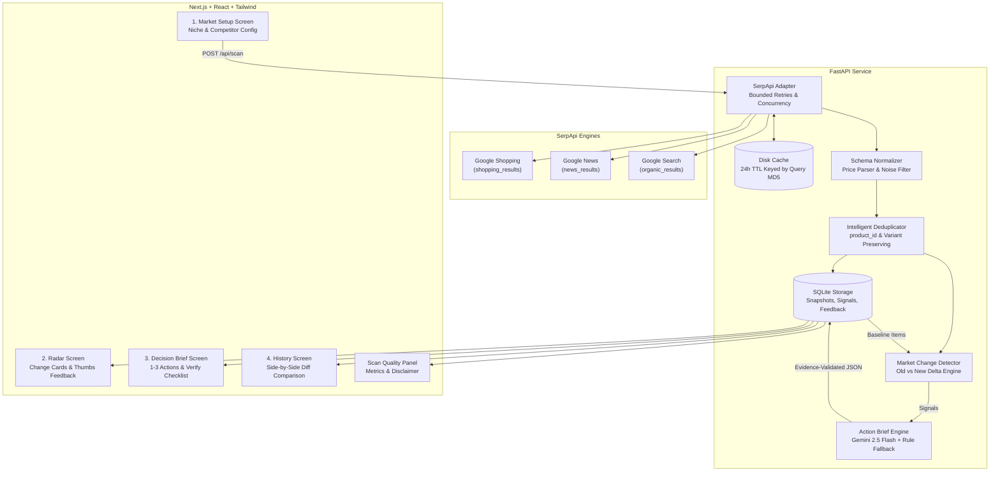
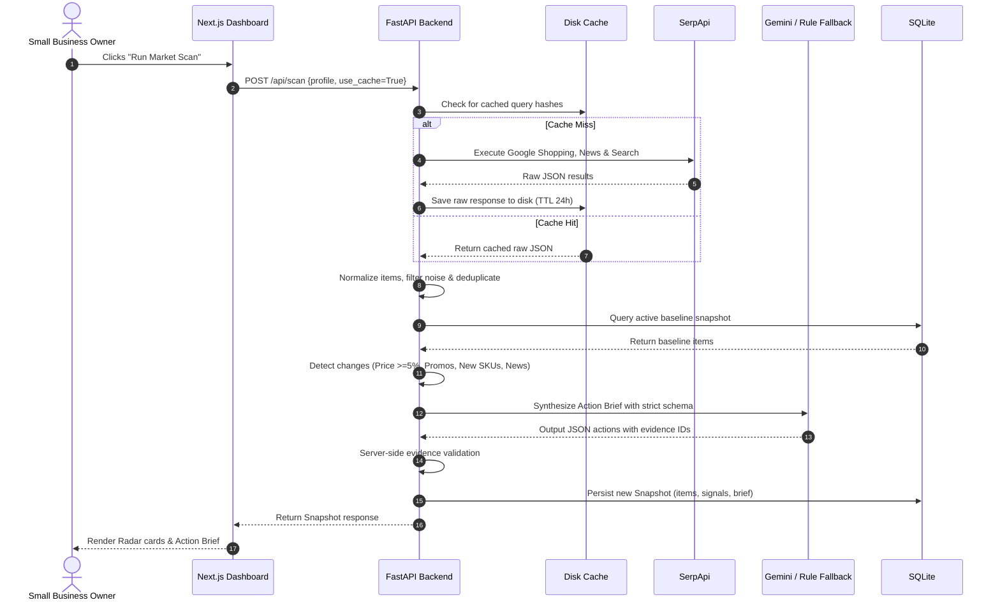

# RippleWatch — Technical Architecture

RippleWatch is an AI market-change intelligence agent designed for small businesses. Rather than flooding business owners with noisy price charts, RippleWatch watches the public market around a business, detects meaningful competitor shifts, explains why they matter, and recommends 1–3 low-overhead commercial next actions backed by clickable evidence.

---

## 1. High-Level Architecture Diagram

---

## 2. Core Components

### 2.1 SerpApi Adapter (`backend/app/serpapi_client.py`)
- **Multi-Engine Ingestion**:
  - `engine=google_shopping`: Extracts live catalog SKUs, merchant listings, delivery terms, and current pricing.
  - `engine=google_news`: Tracks recent press releases, product launches, and strategic announcements.
  - `engine=google_search`: Captures promotional campaigns, discount landing pages, and coupon offers.
- **Targeted Query Strategy**:
  - Catalog query: `"{competitor} {category}"`
  - Promotion query: `"{competitor} {category} bundle OR combo OR offer"`
  - Media query: `"{competitor} {category} launch OR release OR price"`
- **Disk Caching & Quota Protection**:
  - Keyed by `MD5(engine + query + gl + hl)`.
  - Configurable TTL (default 24 hours).
  - Toggled via the `"use_cache"` parameter in scan requests to protect hackathon quota.
- **Resilience**:
  - Bounded exponential backoff retries (3 attempts) on rate limits (429) or upstream timeouts.

### 2.2 Normalizer & Deduplicator (`backend/app/normalizer.py`)
- **Unified Schema (`MarketItem`)**:
  - `id`: Deterministic hash (`sha256(source_type + unique_seed)[:16]`)
  - `source_type`: `shopping` | `news` | `search`
  - `query`, `title`, `seller_or_source`, `url`, `snippet`
  - `price` (float) & `currency` (`INR`)
  - `product_id`: SerpApi doc/catalog ID if present
  - `location_context`: `in` (India)
  - `observed_at`: UTC ISO timestamp
- **Noise Filter**:
  - Identifies and excludes irrelevant accessories (cleaning brushes, silicone sleeves, replacement caps, straws) and directory spam.
- **Variant-Preserving Deduplication**:
  - Matches on `product_id` first.
  - Matches on normalized `(title + seller)` second.
  - Retains volume and model specifications (e.g., 500ml vs 1000ml) to ensure variants are not collapsed.

### 2.3 Market Change Detector (`backend/app/detector.py`)
Compares the current snapshot against the active baseline snapshot and generates signals across 4 types:

1. **`PRICE_CHANGE`**:
   - Triggers when matched product exhibits `abs(new_price - old_price) / old_price >= 0.05` (≥5% price movement).
   - Generates old vs new change statement.
2. **`PROMOTION`**:
   - Detects newly appearing promotional keywords (`combo`, `bundle`, `pack of 2`, `bogo`, `% off`, `flat discount`, `deal of the day`).
3. **`NEW_PRODUCT`**:
   - Identifies new SKUs cataloged by tracked competitors that were absent in the baseline.
4. **`NEWS`**:
   - Identifies new media articles regarding competitor launches, production changes, or expansion.

#### Confidence Scoring:
- **`confirmed`**: Corroborated across 2+ independent retailers/platforms.
- **`likely`**: High-clarity single direct retailer listing or reputable publication.
- **`possible`**: Scraped organic snippet or single directory mention.

#### Suppression Loop:
- When users click `Irrelevant` on any signal card, the competitor and title token are persisted in the `feedback` table and automatically suppressed from future detection passes.

---

### 2.4 Action Brief Engine (`backend/app/brief_generator.py`)
- **LLM Layer**: Google Gemini via the `google-genai` SDK (`gemini-2.5-flash`).
- **Strict Governance Constraints**:
  - Strictly limited to the normalized signal and evidence payload.
  - Prompt explicitly forbids inferring sales volume, revenue, inventory, or market share.
  - Recommendations are for **human approval only** (never automated repricing).
  - Every action must include `evidence_ids` referencing real IDs.
  - Server-side validation drops any claim referencing invalid or non-existent IDs.
  - Retries up to 2 times on validation error.
- **Deterministic Rule Engine Fallback**:
  - If `GEMINI_API_KEY` is missing or the API call fails, the deterministic rule engine analyzes the detected signals and outputs 1–3 practical next actions matching the exact schema with validated evidence citations.

---

## 3. Data Flow Sequence

